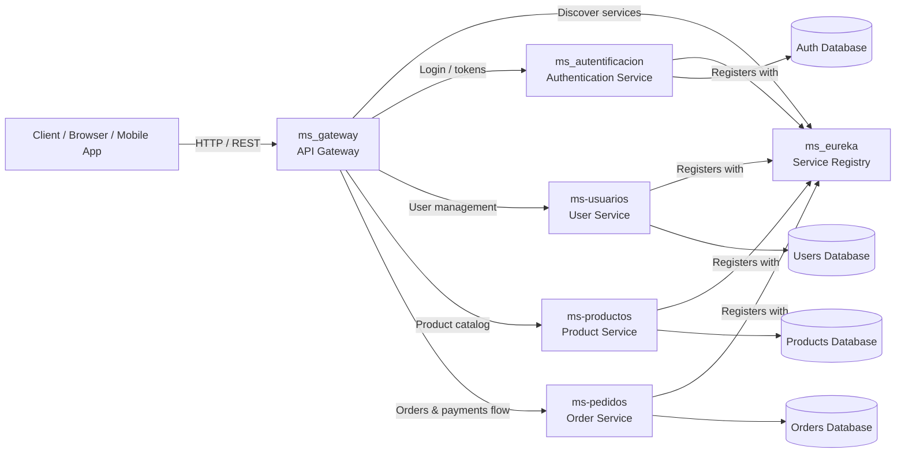

# Architecture Overview

This repository is organized as a Spring Cloud microservices architecture. The main entry point is the API Gateway, which routes client requests to the appropriate service. Eureka provides service discovery, allowing services to register and discover one another without hardcoded endpoints.

## Service responsibilities

- `ms_gateway`: central API entry point and request routing
- `ms_eureka`: service registry and discovery
- `ms_autentificacion`: authentication and authorization logic
- `ms-usuarios`: user profile and account-related operations
- `ms-productos`: catalog and product management
- `ms-pedidos`: order creation and order processing

This design provides independent deployment, scalability, and fault isolation for each business capability.